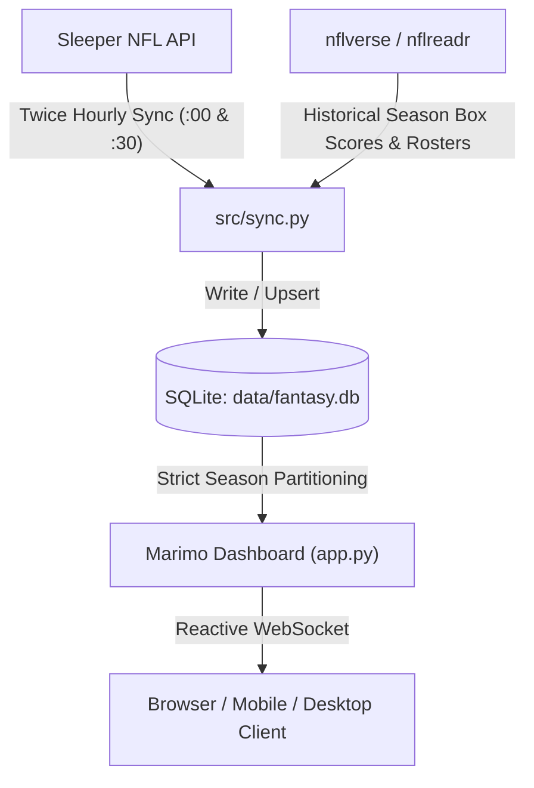
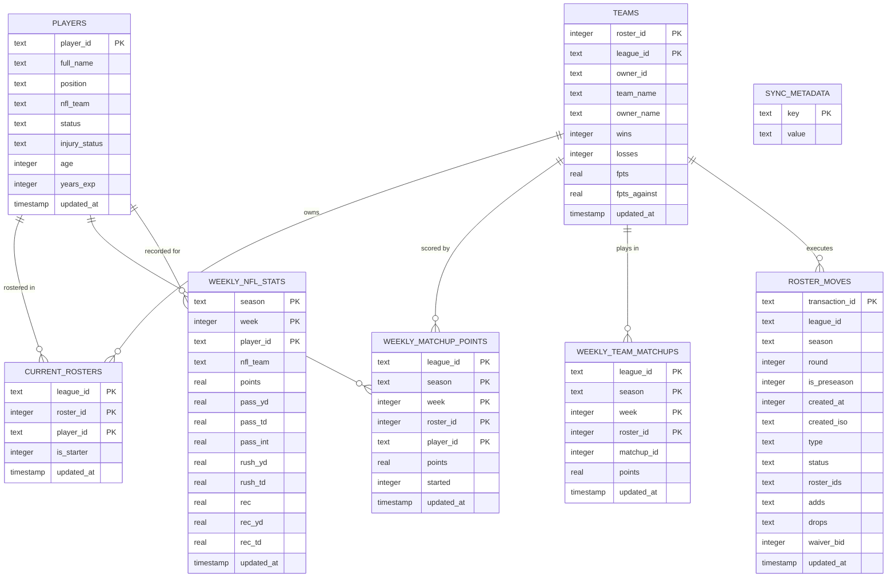

# 🏈 NFL Fantasy Analytics & Decision-Support Dashboard

A self-hosted, high-performance fantasy football analytics and decision-support platform built with **Marimo**, **Pandas**, **Altair**, and **SQLite**. Designed for continuous 24/7 operation on a **Raspberry Pi**, local machines, or cloud Docker environments with automated incremental data syncing from the **Sleeper API** and **nflverse**.

---

## 📑 Table of Contents
- [Overview & Key Features](#-overview--key-features)
- [Architecture & Tech Stack](#%EF%B8%8F-architecture--tech-stack)
- [Analytical Models & Details](#-analytical-models--details)
  - [Trade Value (TV) & VORP Model](#1-trade-value-tv--vorp-model)
  - [Multi-Season History Engine & Historical Rosters](#2-multi-season-history-engine--historical-rosters)
  - [Zero-Cache-Miss Reactive Visualization](#3-zero-cache-miss-reactive-visualization)
- [Database Schema](#-database-schema)
- [Terminal Commands & Data Management](#-terminal-commands--data-management)
  - [Local Sync & Historical Scraping (`fetch_local_data.py`)](#1-local-sync--historical-scraping-scriptsfetch_local_datapy)
  - [Truncate & Clean Overwrites](#2-truncate--clean-overwrites)
  - [Interactive SQL Shell & Pre-built Queries](#3-interactive-sql-shell--pre-built-queries)
- [Local Installation (Without Docker)](#-local-installation-without-docker)
- [Docker & Containerization](#-docker--containerization)
- [Raspberry Pi & Local Network Setup](#-raspberry-pi--local-network-setup)

---

## 🌟 Overview & Key Features

The dashboard provides a complete analytical suite for competitive fantasy football leagues:

* **👑 League Overview & Power Rankings**:
  * Real-time league standings with Points For (PF), Points Against (PA), and Total Roster Trade Value.
  * Advanced luck metrics (All-Play records, expected wins, schedule difficulty, and luck index).
  * Key league performance benchmarks (leader, top offense, toughest schedule, deepest bench).

* **🛡️ Team Analytics**:
  * Comprehensive roster breakdown with starters vs. bench performance.
  * Positional depth charts (QB, RB, WR, TE, K, DEF) and team trade value accumulation.
  * Target vs. optimal weekly score differential analysis.

* **⚡ Lineup Optimizer**:
  * Linear programming lineup solver with selectable risk profiles (*Optimal Expected*, *Floor-Safe*, *Ceiling Upside*).
  * Weather alerts (wind, precipitation, temperature) and injury risk penalties.
  * Starter recommendations vs. current sleeper lineup.

* **💎 Player Market & Trade Radar**:
  * League-wide player trade values on a standardized 0–100 scale (strictly rostered players).
  * Algorithmic **Buy-Low candidates** (high-scoring players temporarily discounted by short injury or low GP).
  * Algorithmic **Sell-High candidates** (healthy players with high trade leverage and elevated volatility).
  * Interactive Trade Value vs. PPG scatter plot with team color coding.

* **🔄 Trade Finder & Custom Simulator**:
  * Automated 1-for-1 and 2-for-2 trade recommendations based on team surplus and positional deficits.
  * Custom multi-player trade simulator recalculating post-trade starting lineup points and trade value deltas.

* **👤 Player Profiles & Multi-Season Logs**:
  * Complete regular-season box scores across 2026, 2025, and 2024.
  * Horizontally scrollable bar chart sorted reverse-chronologically (newest games first).
  * Dynamic franchise color badges and full team names (e.g. Kenneth Walker displays both *Kansas City Chiefs* and *Seattle Seahawks*).
  * Transparent Trade Value breakdown formula (PPG, Baseline, VORP, Scarcity, Tier Multiplier).
  * Full analytics support for active waiver wire / free agent players.

* **⚔️ Head-to-Head Player Comparison**:
  * Side-by-side comparison of any two NFL players filtered strictly to the current active season (2026).
  * Weekly head-to-head bar charts and consistency comparisons.

* **📜 Roster Moves Revisitor & Grader**:
  * Retrospective analysis of completed waiver pickups, free agent adds, and trades.
  * Win-rate impact and net fantasy points gained or lost per transaction.

---

## 🛠️ Architecture & Tech Stack



* **Frontend & Web Runtime**: [Marimo](https://marimo.io) (Reactive Python notebook & web app engine)
* **Data Processing**: Pandas, NumPy, Scipy (linear programming)
* **Visualization**: Altair & Vega-Lite (rendered with inline base64 CSV to prevent virtual file cache misses)
* **Database**: SQLite 3 (`data/fantasy.db`) with WAL mode enabled
* **Scheduling**: In-process background scheduler + Docker cron (syncs every 30 min at `:00` and `:30`)
* **Containerization**: Docker Compose (multi-stage Debian-based Python 3.11 image)

---

## 🧠 Analytical Models & Details

### 1. Trade Value (TV) & VORP Model

Player market value is evaluated using **Value Over Replacement Player (VORP)** contextualized to your league settings (e.g. 6-team starting roster sizes):

$$\text{VORP} = \max(0, \, \text{PPG} - \text{Positional Baseline})$$

$$\text{Raw Value} = \Big(\text{VORP} \times 3.5 \times W_{\text{pos}} + \text{PPG} \times 1.1 \times W_{\text{pos}}\Big) \times M_{\text{elite}} \times D_{\text{injury}}$$

$$\text{Trade Value} = \text{round}\left(\frac{\text{Raw Value}}{\text{Benchmark}_{\max}} \times 98.0, \, 1\right)$$

* **Positional Replacement Baselines**:
  * `QB: 14.5 FPTS` | `RB: 7.5 FPTS` | `WR: 8.0 FPTS` | `TE: 5.5 FPTS` | `K: 6.5 FPTS` | `DEF: 5.5 FPTS`
* **Positional Scarcity Multipliers ($W_{\text{pos}}$)**:
  * `RB: 1.45×` (highest scarcity, heavy starting demand)
  * `TE: 1.35×` (massive positional advantage at the top)
  * `WR: 1.30×` (high depth, dependable starting anchor)
  * `QB: 0.85×` (in 1-QB leagues, streamable depth is abundant)
  * `DEF: 0.40×` | `K: 0.30×`
* **Elite Tier Multiplier ($M_{\text{elite}}$)**:
  * Exponential leverage for league-winning studs (Top 3 RB/WR get up to `1.35×`, Top 2 TE get `1.40×`, Top 2 QB get `1.25×`).
* **Injury Discount ($D_{\text{injury}}$)**:
  * `Out / IR / PUP`: `0.60×`
  * `Questionable`: `0.90×`
  * `Healthy`: `1.00×`
* **Free Agents / Waivers**:
  * Unowned players receive an identical evaluation so fantasy managers can measure waiver wire targets directly against bench assets.
  * The dedicated **Player Market** tab automatically filters strictly to rostered players to preserve clean trade market analysis.

### 2. Multi-Season History Engine & Historical Rosters

* **Historical Season Scraping**:
  * Automatically downloads regular-season box scores from `nflverse-data/player_stats`.
  * Computes fantasy points according to **exact league scoring rules** (passing, rushing, receiving, PPR).
* **Multi-Team Tracking**:
  * Integrates historical nflverse rosters (`roster_{season}.csv.gz`) to assign every player the precise NFL team they played for during that season.
  * Mid-career trades and free agency signings (e.g. Kenneth Walker: Seattle Seahawks in 2024/2025 $\rightarrow$ Kansas City Chiefs in 2026) are correctly captured on a per-game basis with individual team franchise color codes.

### 3. Zero-Cache-Miss Reactive Visualization

To eliminate server errors (`KeyError: Virtual file not found: ...arrow`) common in long-running Marimo deployments:
* Altair charts are configured with the **`marimo_inline_csv`** transformer.
* Game logs and market scatter data are serialized directly into base64 data URLs in the Vega-Lite specification.
* This guarantees instant chart rendering without server-side virtual file lifecycles or 404 cache misses during background re-syncs or server restarts.

---

## 🗄️ Database Schema

The database (`data/fantasy.db`) stores current league states, player registries, matchup results, and multi-season game logs.



### Table Breakdown

| Table | Primary Key | Description |
| :--- | :--- | :--- |
| `players` | `player_id` | Master NFL player database (names, positions, NFL teams, injury tags, experience). |
| `teams` | `(roster_id, league_id)` | League teams, owner handles, records, total points for (PF) and against (PA). |
| `current_rosters` | `(league_id, roster_id, player_id)` | Active ownership snapshot and starter vs. bench assignment. |
| `weekly_matchup_points` | `(league_id, season, week, roster_id, player_id)` | Player fantasy points scored in specific weekly league matchups. |
| `weekly_nfl_stats` | `(season, week, player_id)` | NFL box scores & league scoring points across all historical seasons. |
| `weekly_team_matchups` | `(league_id, season, week, roster_id)` | Total weekly team scores and head-to-head matchup IDs. |
| `roster_moves` | `transaction_id` | Historical transactions (waiver bids, free agent claims, trades, drops). |
| `sync_metadata` | `key` | Metadata tracking `active_season`, `current_week`, and `last_sync` timestamps. |

---

## 💻 Terminal Commands & Data Management

The CLI utility [`scripts/fetch_local_data.py`](file:///Users/jonas/Documents/GitHub/NFL-Fantasy-Dashboard/scripts/fetch_local_data.py) provides full control over data synchronization, historical scraping, and database inspection.

### 1. Local Sync & Historical Scraping (`fetch_local_data.py`)

```bash
# Display database statistics, row counts, and last sync timestamp
./scripts/fetch_local_data.py --info

# Perform incremental sync (fetches latest week, rosters, matchups, and transactions)
./scripts/fetch_local_data.py --sync

# Full synchronization including full NFL player metadata refresh
./scripts/fetch_local_data.py --sync --mode full --force-players

# Download and calculate full historical 2024 season stats
./scripts/fetch_local_data.py --sync-2024

# Download and calculate full historical 2025 season stats
./scripts/fetch_local_data.py --sync-2025

# Download historical stats for any specific year (e.g. 2023)
./scripts/fetch_local_data.py --sync-season 2023
```

### 2. Truncate & Clean Overwrites

Use the `-t` or `--truncate` flag to wipe existing records for a season before loading fresh data. This guarantees that updated roster changes or scoring corrections are applied cleanly:

```bash
# Clean overwrite of 2025 historical data
./scripts/fetch_local_data.py --sync-2025 -t

# Clean overwrite of 2024 historical data
./scripts/fetch_local_data.py --sync-2024 --truncate

# Clean overwrite of an arbitrary season
./scripts/fetch_local_data.py --sync-season 2023 -t

# Wipe current active season stats before re-syncing
./scripts/fetch_local_data.py --sync -t
```

### 3. Interactive SQL Shell & Pre-built Queries

```bash
# Open interactive SQL shell directly into fantasy.db
./scripts/fetch_local_data.py -i

# Execute an arbitrary SQL query from the command line
./scripts/fetch_local_data.py -q "SELECT player_name, mean_points FROM players WHERE position = 'QB' LIMIT 10;"

# View pre-built query examples
./scripts/fetch_local_data.py --examples

# Run a pre-built example query (e.g. Top scorers of current week)
./scripts/fetch_local_data.py --example 1
```

---

## 💻 Local Installation (Without Docker)

If you prefer running the application directly on your local machine (macOS / Linux / Windows) without Docker:

### 1. Clone & Set Up Python Environment
```bash
git clone https://github.com/Sunkarr/NFL-Fantasy-Dashboard.git
cd NFL-Fantasy-Dashboard

# Create and activate virtual environment (Python 3.10+ recommended)
python3 -m venv .venv
source .venv/bin/activate  # On Windows: .venv\Scripts\activate

# Install all dependencies
pip install --upgrade pip
pip install -r requirements.txt
```

### 2. Configure Environment Variables
```bash
cp .env.example .env
nano .env  # Add your LEAGUE_ID and TEAM_NAME
```

### 3. Initialize & Fetch League Data
```bash
# Sync current active season data from Sleeper into SQLite
./scripts/fetch_local_data.py --sync

# Fetch historical seasons for player profile logs & multi-year charts
./scripts/fetch_local_data.py --sync-2025
./scripts/fetch_local_data.py --sync-2024
```

### 4. Start the Dashboard
```bash
# Production mode (fast presentation view)
marimo run app.py

# Interactive development mode (inspect/edit cells in real time)
marimo edit app.py

# Specify custom host or port if needed
marimo run app.py --host 0.0.0.0 --port 8501
```
Open `http://localhost:2718` (or `http://localhost:8501`).

---

## 🐳 Docker & Containerization

### Quick Start with Docker Compose

1. **Clone the repository**:
   ```bash
   git clone https://github.com/Sunkarr/NFL-Fantasy-Dashboard.git
   cd NFL-Fantasy-Dashboard
   ```
2. **Configure your environment**:
   ```bash
   cp .env.example .env
   ```
   Edit `.env`:
   ```dotenv
   LEAGUE_ID=your_sleeper_league_id
   TEAM_NAME=your_team_name
   TZ=Europe/Berlin
   SYNC_CRON=0,30 * * * *
   PORT=8501
   ```
3. **Build & Start**:
   ```bash
   docker compose up -d --build
   ```
4. **Access the Dashboard**:
   Open `http://localhost:8501` (or your server's IP address).

---

## 🍓 Raspberry Pi & Local Network Setup

Running this dashboard on a Raspberry Pi alongside other local services (such as **Homebridge**) works seamlessly without port collisions:
* **Homebridge UI**: Runs on port `8581`.
* **Fantasy Dashboard**: Runs on port `8501`.

### Option A: Zero-Config (`http://<hostname>.local:8501`)
Keep your Pi's existing hostname (e.g. `homebridge` or `raspberrypi`):
* Dashboard URL: `http://homebridge.local:8501`

### Option B: Dedicated Local Domain (`http://fantasy.home`)
Route via local DNS (Pi-hole, AdGuard, Fritz!Box) and an Nginx reverse proxy on port 80:

```nginx
# /etc/nginx/sites-available/fantasy
server {
    listen 80;
    server_name fantasy.home fantasy.lan;

    location / {
        proxy_pass http://127.0.0.1:8501;
        proxy_http_version 1.1;
        proxy_set_header Upgrade $http_upgrade;
        proxy_set_header Connection "upgrade";
        proxy_set_header Host $host;
    }
}
```
Now `http://fantasy.home` directly opens the dashboard without specifying a port number.
